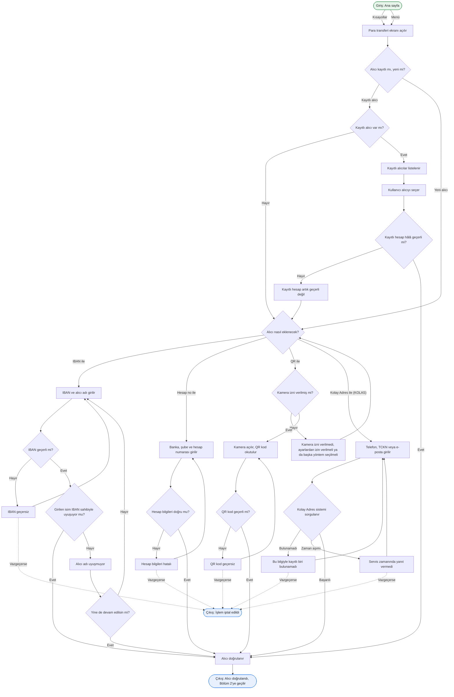
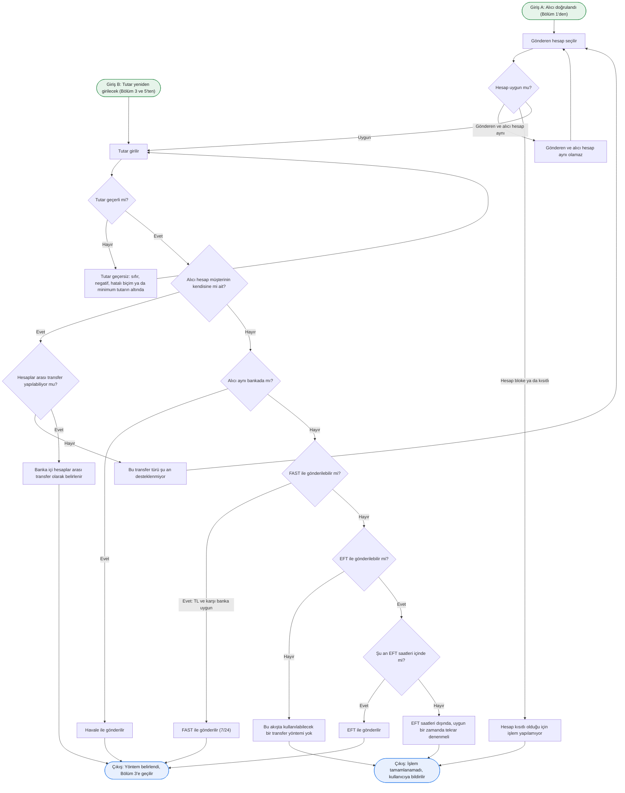
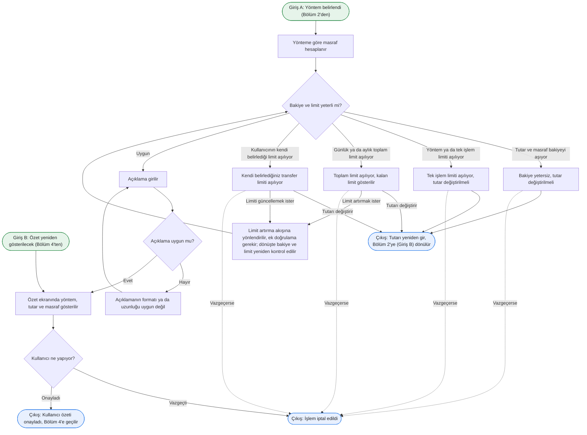
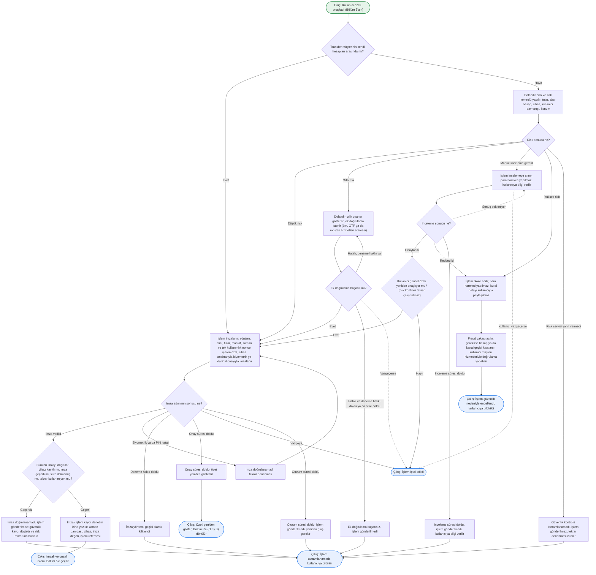
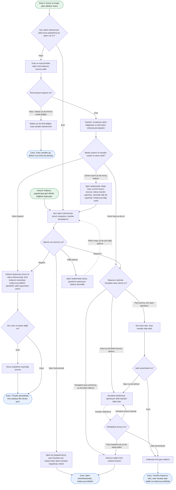

# Para Transferi Akış Diyagramı

Bir para transferi akışının beş parçaya bölünmüş Mermaid diyagramı ve bu akıştan türetilen 52 test senaryosu. Akış genel bir modeldir; belirli bir bankanın sistemini yansıtmaz. Limit, süre ve deneme sayıları örnek varsayımdır.

Bu çalışmanın anlatıldığı yazı: [Para Transferi Akışını Test Uzmanı Gözüyle Okumak](MEDIUM_LINKI_BURAYA)

## İçindekiler

- [1. Alıcı Seçimi ve Doğrulama](#s)
- [2. Hesap Seçimi ve Transfer Yöntemi Belirleme](#sss)
- [3. Masraf, Bakiye, Limit, Açıklama ve Özet](#s)
- [4. Güvenlik: Risk Kontrolü ve Dijital İmza](#s)
- [5. Rezervasyon, Gönderim, Sonuç ve İade Yönetimi](#ss)
- [Test senaryoları](#test-senaryoları)

Her parçanın çıkış düğümü bir sonrakinin giriş düğümüne bağlanır (Giriş/Çıkış düğümleri yeşil ve mavi).

## 1. Alıcı Seçimi ve Doğrulama

## 2. Hesap Seçimi ve Transfer Yöntemi Belirleme

## 3. Masraf, Bakiye, Limit, Açıklama ve Özet

## 4. Güvenlik: Risk Kontrolü ve Dijital İmza

## 5. Rezervasyon, Gönderim, Sonuç ve İade Yönetimi

## Test senaryoları

### 1. Alıcı Seçimi ve Doğrulama

| Test | Açıklama | Test adımı | Beklenen sonuç |
| --- | --- | --- | --- |
| T1 | Kullanıcı, ana sayfadan para transferi ekranına gider. | 1. Ana sayfa → Para transferi ekranı açılır | Para transferi ekranı açılır |
| T2 | Kullanıcı, kayıtlı bir alıcı seçer. | 2. Kayıtlı alıcı var mı? → Evet → Alıcı seçimi | Alıcı listesi gösterilir, kullanıcı alıcıyı seçer |
| T33 | Kullanıcı, kayıtlı alıcısı olmadığı halde “Kayıtlı alıcı” seçeneğini seçer. | 33. Kayıtlı alıcı var mı? → Hayır → Alıcı nasıl eklenecek? | Alıcı ekleme yöntemi seçimi (IBAN, hesap no, QR, Kolay Adres) gösterilir |
| T3 | Kullanıcı, geçersiz IBAN girer. | 3. IBAN girilir → IBAN geçersiz → Hata mesajı | "IBAN geçersiz" mesajı gösterilir |
| T4 | Kullanıcı, alıcı adı ile IBAN uyuşmuyorsa devam eder. | 4. Alıcı adı uyuşmuyor → "Yine de devam edilsin mi?" → Evet | Alıcı doğrulanır, işlem devam eder |
| T34 | Kullanıcı, hata mesajını gördükten sonra işlemden vazgeçer. | 34. IBAN geçersiz → Vazgeçerse → İşlem iptal edilir | İşlem iptal edilir, para hareketi olmaz |
| T5 | Kullanıcı, kolay adres ile alıcı ekleme yapar. | 5. Kolay Adres → Telefon, TCKN veya e-posta girilir → Sorgulanır | Sistemde kayıtlı bir kullanıcı bulunuyorsa, kullanıcı seçilebilir |
| T43 | Kullanıcı, QR ile ekler ama kamera izni verilmemiştir. | 43. QR ile → Kamera izni verilmiş mi? → Hayır | Kamera izni gerektiği bildirilir, ayarlardan izin verilmesi ya da başka yöntem seçilmesi istenir, alıcı ekleme yöntemi seçimine dönülür |

### 2. Hesap Seçimi ve Transfer Yöntemi Belirleme

| Test | Açıklama | Test adımı | Beklenen sonuç |
| --- | --- | --- | --- |
| T6 | Kullanıcı, aynı hesaptan transfer yapmaya çalışır. | 6. Gönderen ve alıcı hesap aynı → Hata mesajı | "Gönderen ve alıcı hesap aynı olamaz" mesajı gösterilir |
| T7 | Kullanıcı, bloke bir hesaptan transfer yapmaya çalışır. | 7. Hesap bloke → Hata mesajı | "Hesap kısıtlı olduğu için işlem yapılamıyor" mesajı gösterilir |
| T44 | Kullanıcı, geçersiz tutar girer (sıfır, negatif, hatalı biçim ya da minimum tutarın altı). | 44. Tutar girilir → Tutar geçerli mi? → Hayır | Tutar geçersiz bilgisi verilir, tutar girişine dönülür, sonraki adıma geçilmez |
| T45 | Kullanıcı, kendi hesapları arasında transfer yapar. | 45. Alıcı hesap müşterinin kendisine ait → Hesaplar arası transfer yapılabiliyor mu? → Evet | Banka içi hesaplar arası transfer olarak belirlenir |
| T46 | Kullanıcı, kendi hesapları arasında transfer yapar ama bu transfer türü kapalıdır. | 46. Alıcı hesap müşterinin kendisine ait → Hesaplar arası transfer yapılabiliyor mu? → Hayır | "Bu transfer türü şu an desteklenmiyor" mesajı gösterilir, hesap seçimine dönülür |
| T8 | Kullanıcı, aynı banka içinde transfer yapar. | 8. Alıcı müşterinin kendisi değil → Alıcı aynı bankada → Havale | Havale ile gönderilir |
| T9 | Kullanıcı, farklı banka içinde transfer yapar. | 9. Alıcı farklı bankada → FAST ile gönderilebilir mi? → Evet | FAST ile gönderilir |
| T10 | Kullanıcı, farklı bankaya transfer yapar ve FAST uygun değildir. | 10. Alıcı farklı bankada → FAST ile gönderilebilir mi? → Hayır → EFT ile gönderilebilir mi? → Evet → EFT saatleri içinde → Evet | EFT ile gönderilir |
| T47 | Kullanıcı, FAST ve EFT ile gönderilemeyen bir alıcıya transfer yapar. | 47. FAST ile gönderilebilir mi? → Hayır → EFT ile gönderilebilir mi? → Hayır | "Bu akışta kullanılabilecek bir transfer yöntemi yok" mesajı gösterilir, işlem tamamlanmaz |
| T11 | Kullanıcı, EFT saatleri dışında transfer yapmaya çalışır. | 11. EFT saatleri dışında → Hata mesajı | "EFT saatleri dışında, uygun bir zamanda tekrar denenmeli" mesajı gösterilir |

### 3. Masraf, Bakiye, Limit, Açıklama ve Özet

| Test | Açıklama | Test adımı | Beklenen sonuç |
| --- | --- | --- | --- |
| T12 | Kullanıcı, bakiyesi yetersiz tutar girer. | 12. Bakiye yetersiz → Tutar değiştirilmeli | "Bakiye yetersiz, tutar değiştirilmeli" mesajı gösterilir |
| T35 | Kullanıcı, bakiye yetersiz uyarısından sonra işlemden vazgeçer. | 35. Bakiye yetersiz → Vazgeçerse → İşlem iptal edilir | İşlem iptal edilir, para hareketi olmaz |
| T13 | Kullanıcı, tek işlem limitini aşıyor. | 13. Tek işlem limiti aşıldı → Tutar değiştirilmeli | "Tek işlem limiti aşılıyor, tutar değiştirilmeli" mesajı gösterilir |
| T14 | Kullanıcı, günlük limiti aşıyor. | 14. Günlük limit aşıldı → Kullanıcıya kalan limit gösterilir | "Toplam limit aşılıyor, kalan limit gösterilir" mesajı gösterilir |
| T15 | Kullanıcı, limitini artırma istiyor. | 15. Limit artırma istenir → Limit artırma akışına yönlendirilir | Limit artırma akışı başlatılır |
| T16 | Kullanıcı, kendi belirlediği limiti aşıyor. | 16. Kullanıcının kendi belirlediği limit aşıldı → Tutar değiştirilmeli | "Kendi belirlediğiniz transfer limiti aşılıyor" mesajı gösterilir |
| T17 | Kullanıcı, açıklamayı yanlış girer. | 17. Açıklama formatı uygun değil → Hata mesajı | "Açıklamanın formatı ya da uzunluğu uygun değil" mesajı gösterilir |
| T18 | Kullanıcı, açıklamayı doğru girer. | 18. Açıklama uygun → Özet ekranı gösterilir | Özet ekranı gösterilir, kullanıcı onaylar |
| T19 | Kullanıcı, işlemi iptal eder. | 19. İptal eder → İşlem durdurulur | İşlem iptal edilir |

### 4. Güvenlik: Risk Kontrolü ve Dijital İmza

| Test | Açıklama | Test adımı | Beklenen sonuç |
| --- | --- | --- | --- |
| T20 | Kullanıcı, düşük riskli işlem yapar. | 20. Düşük risk → İmza verilir | İmza verilir, işlem devam eder |
| T49 | Kullanıcı, kendi hesapları arasında transfer yapar. | 49. Transfer kendi hesapları arasında → Risk kontrolü atlanır → İmza | Risk kontrolü ve ek doğrulama istenmeden doğrudan imza adımına geçilir |
| T21 | Kullanıcı, orta riskli işlem yapar. | 21. Orta risk → Ek doğrulama istenir | Ek doğrulama istenir |
| T48 | Kullanıcı, orta riskli işlemde ek doğrulamayı yanlış girer ama deneme hakkı vardır. | 48. Orta risk → Ek doğrulama → Hatalı, deneme hakkı var | Ek doğrulama tekrar istenir, işlem gönderilmez |
| T22 | Kullanıcı, ek doğrulama başarısız olur. | 22. Ek doğrulama başarısız → İşlem gönderilmez | "Ek doğrulama başarısız, işlem gönderilmedi" mesajı gösterilir |
| T23 | Kullanıcı, yüksek riskli işlem yapar. | 23. Yüksek risk → İşlem bloke edilir | İşlem bloke edilir, fraud vakası açılır |
| T36 | İşlem manuel incelemeye düşer. | 36. Risk sonucu → Manuel inceleme gerekli → İşlem incelemeye alınır | İşlem incelemeye alınır, para hareketi yapılmaz, kullanıcıya bilgi verilir |
| T37 | İnceleme onaylanır ve kullanıcı güncel özeti yeniden onaylar. | 37. İnceleme sonucu → Onaylandı → Kullanıcı güncel özeti onaylar → İmza adımı | Risk kontrolü tekrar çalışmaz, doğrudan imza adımına geçilir |
| T38 | İnceleme onaylanır ama kullanıcı güncel özeti onaylamaz. | 38. İnceleme sonucu → Onaylandı → Kullanıcı güncel özeti onaylamaz | İşlem iptal edilir, para hareketi olmaz |
| T39 | İnceleme reddedilir. | 39. İnceleme sonucu → Reddedildi → İşlem bloke edilir | İşlem bloke edilir, fraud vakası açılır, kullanıcıya güvenlik nedeniyle engellendi bilgisi verilir |
| T40 | İnceleme süresi dolar. | 40. İnceleme sonucu → İnceleme süresi doldu | “İnceleme süresi doldu, işlem gönderilmedi” bilgisi verilir, işlem gönderilmez |
| T41 | Kullanıcı, inceleme beklerken işlemden vazgeçer. | 41. İşlem incelemede → Kullanıcı vazgeçerse → İşlem iptal edilir | İşlem iptal edilir, para hareketi olmaz |
| T24 | Kullanıcı, imza doğrulanamaz. | 24. İmza doğrulanamaz → Hata mesajı | "İmza doğrulanamadı" mesajı gösterilir |
| T25 | Kullanıcı, imza süresi doldu. | 25. Onay süresi doldu → Özet yeniden gösterilir | Özet yeniden gösterilir |
| T26 | Kullanıcı, imza verilir. | 26. İmza verilir → Sunucu doğrular | Sunucu imzayı doğrular, işlem devam eder |
| T50 | Kullanıcının oturumu imza adımında sona erer. | 50. İmza adımı → Oturum süresi doldu | "Oturum süresi doldu, işlem gönderilmedi" bilgisi verilir, yeniden giriş istenir, para hareketi olmaz |

### 5. Rezervasyon, Gönderim, Sonuç ve İade Yönetimi

| Test | Açıklama | Test adımı | Beklenen sonuç |
| --- | --- | --- | --- |
| T42 | Rezervasyon sırasında bakiye ya da limit değişmiştir. | 42. Rezervasyon → Başarısız → Tutar yeniden belirlenmeli | “Bakiye ya da limit değişti, tutar yeniden belirlenmeli” bilgisi verilir, tutar girişine dönülür |
| T51 | Aynı işlem referansıyla ikinci istek gelir (çift dokunma ya da yeniden deneme). | 51. Aynı işlem referansıyla daha önce başlatılmış işlem var mı? → Evet → Durum sorgulanır | Yeni transfer oluşmaz, mevcut işlemin durumu gösterilir |
| T52 | Gönderim sırasında bağlantı kopar, kullanıcı uygulamaya geri döner. | 52. Uygulamaya geri dönüş → İşlem referansıyla durum sorgulanır | İşlem varsa gerçek durumu gösterilir, yoksa "işlem başlatılmamış, para hareketi yok" bilgisi verilir |
| T27 | Kullanıcı, işlemi başarıyla tamamlar. | 27. Banka sistemi → Kesin başarılı → Dekont oluşturulur | Dekont oluşturulur, kullanıcıya bildirim gönderilir |
| T28 | Kullanıcı, işlemde hata olur. | 28. Banka sistemi → Hata → Para çıkmış mı? | "Para çıkmış, ters kayıt gerekiyor" → Ters kayıt atılır |
| T29 | Kullanıcı, işlemde sonuç belirsiz. | 29. Banka sistemi → Zaman aşımı → İşlem beklemede | İşlem beklemede tutulur, sorgulanır |
| T30 | Kullanıcı, işlemde hata olur. | 30. Banka sistemi → Hata → Para çıkmamış | "Para çıkmamış, limit serbest bırakılır" |
| T31 | Kullanıcı, iade tamamlanmış. | 31. İade tamamlandı → Limit geri yüklenir | Kullanılan limit geri yüklenir |
| T32 | Kullanıcı, iade tamamlanmamış. | 32. İade tamamlanmamış → Düzeltme bekleniyor | Düzeltme bekleniyor, operasyon ekibi takip eder |
